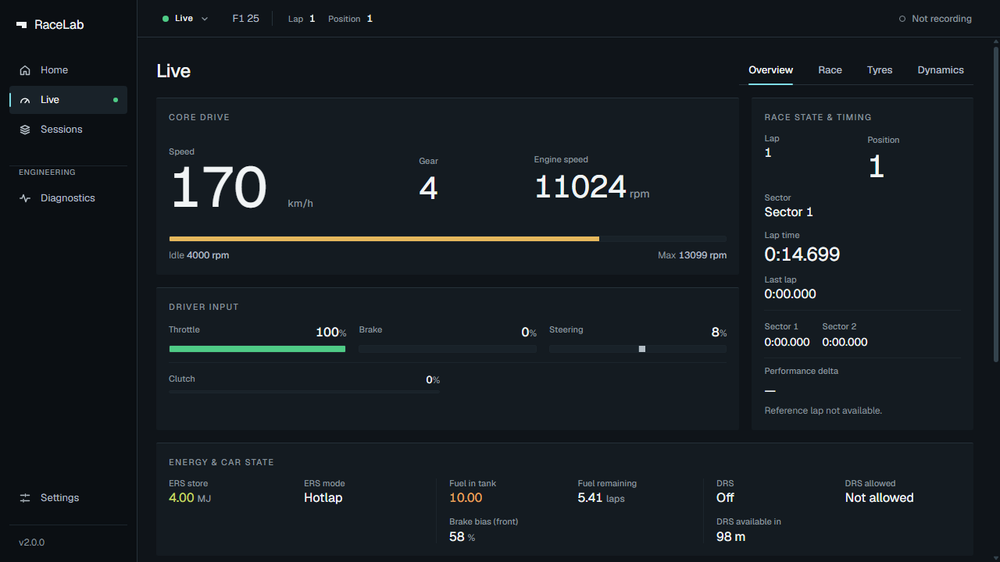
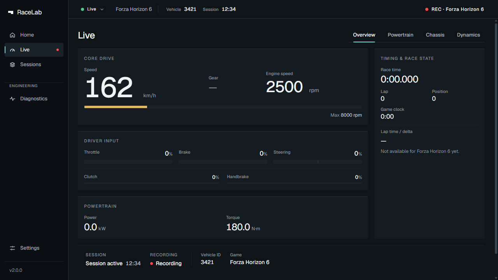
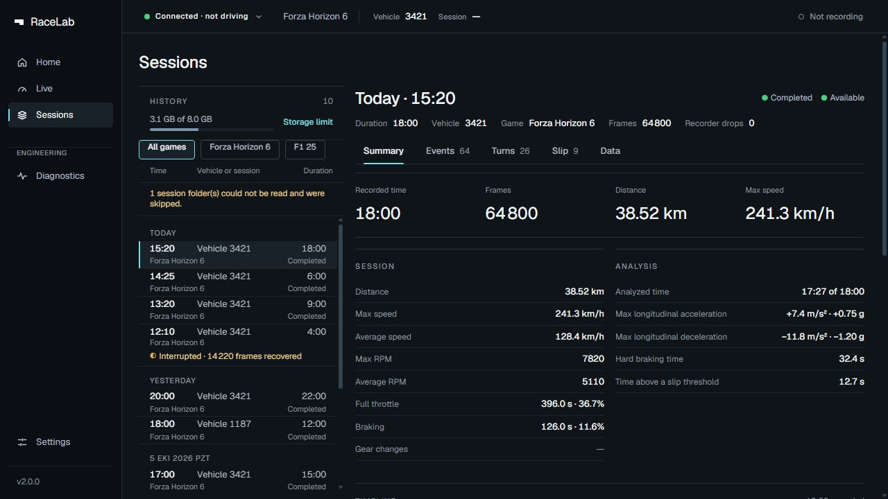
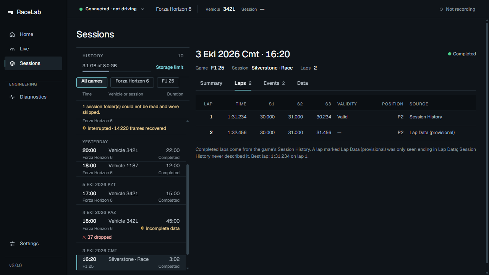
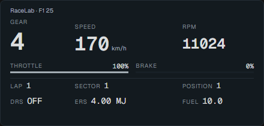

# RaceLab

Windows telemetry, automatic session recording and an in-game overlay for
F1 25 and Forza Horizon 6.

RaceLab keeps live driving data and recorded sessions in one desktop app.
Open it, enable telemetry in your game, and drive. Recordings stay on your PC.

## Screenshots

These are v2.0.0 components captured through the existing development review
harness, **not a live game session**. F1 telemetry replays checked-in decoded
capture values; Forza telemetry and session records are illustrative fixtures.
No private recordings or machine data are used.

| F1 telemetry fixture                                                               | Forza telemetry fixture                                                 |
| ---------------------------------------------------------------------------------- | ----------------------------------------------------------------------- |
|                   |  |
| Mixed-game session history fixture                                                 | F1 lap detail fixture                                                   |
|  |      |

<details>
<summary>Standalone F1 overlay fixture</summary>



The actual overlay component is shown at its native 440×210 size with replayed
fixture values. It is not composited over a game and does not establish native
click-through or live-game acceptance.

</details>

[Capture provenance and reproduction](docs/assets/screenshots/README.md).

## Features

- **Live telemetry:** game-specific views for vehicle data, driver inputs,
  timing and race context. Missing or stale values are shown clearly.
- **Automatic recording:** supported sessions record without a manual start
  button, with completion and interruption status preserved.
- **Mixed-game Sessions:** browse FH6 and F1 25 recordings together, filter by
  game and inspect their details. One game owns the recorder at a time.
- **F1 25:** live player telemetry, persisted sessions, laps, events and session
  context, including tyre and car-state data where available.
- **Forza Horizon 6:** live telemetry, automatic recording, persisted sessions
  and the existing session summaries and driving-event analysis.
- **F1 Telemetry Lab:** open a completed F1 25 session and compare two laps
  on shared distance or time axes: speed, RPM, throttle, brake, steering and
  gear, with synchronized replay. Each lap states its timing source, validity
  and whether its samples support reliable distance-aligned analysis. Two
  qualifying laps are compared at the same lap distance (speed, throttle,
  brake, steering) with a delta time measured from their recorded lap times.
  Verified with synthetic fixtures and automated tests, not yet with a real
  F1 25 recording.
- **F1 overlay:** a compact in-game display that does not take keyboard focus
  during gameplay. Position, scale and opacity are adjustable in Settings.
  The overlay currently supports F1 25.
- **Windows interface:** responsive layouts for Live, Sessions, Settings and
  Diagnostics, with locally bundled Geist fonts.

## Installation

Download the Windows x64 installer from
[Releases](https://github.com/tahagurvardar/racelab/releases) and run it.
For v2.2.0, the installer is `RaceLab_2.2.0_x64-setup.exe`.

Installation is per-user and does not require administrator privileges.
The installer sets up WebView2 if needed. You do not need Node.js, Rust or
this source checkout to use the installed app.

## Game telemetry setup

Run RaceLab and the game on the same Windows PC. Both listeners use the
loopback address `127.0.0.1`; telemetry from consoles or another PC is not
supported.

### F1 25

Open **Game Options → Settings → UDP Telemetry Settings**:

| Setting            | Value       |
| ------------------ | ----------- |
| UDP Telemetry      | On          |
| UDP Broadcast Mode | Off         |
| UDP IP Address     | `127.0.0.1` |
| UDP Port           | `20777`     |
| UDP Send Rate      | `20Hz`      |
| UDP Format         | `2025`      |

### Forza Horizon 6

Open **Settings → HUD and Gameplay → Data Out**:

| Setting             | Value       |
| ------------------- | ----------- |
| Data Out            | On          |
| Data Out IP Address | `127.0.0.1` |
| Data Out IP Port    | `20440`     |

RaceLab detects incoming telemetry automatically. Settings shows setup and
connection status; Diagnostics provides transport and packet details.

## Privacy and storage

RaceLab works locally, without an account or cloud service. It receives game
telemetry over loopback and keeps recordings on disk; it does not upload them.
F1 session storage excludes participant names and network identifiers.

Application data lives under
`%LOCALAPPDATA%\com.tahagurvardar.racelab\`.
Use Settings to configure the storage budget. Retention removes the oldest
eligible finished sessions first and protects sessions being recorded or
processed. Interrupted recordings remain marked as interrupted.

## Development

Windows prerequisites:

- Node.js 22.12 or newer and pnpm
- Rust with the MSVC toolchain
- Visual Studio Build Tools with **Desktop development with C++** and a Windows SDK
- Git

```powershell
powershell -NoProfile -ExecutionPolicy Bypass -File .\scripts\check-env.ps1
pnpm install
pnpm tauri dev
```

Run checks:

```powershell
pnpm check
pnpm exec tsc --noEmit -p review/tsconfig.json
pnpm format:check
pnpm test:frontend
cargo clippy --manifest-path src-tauri/Cargo.toml --all-targets -- -D warnings
cargo test --manifest-path src-tauri/Cargo.toml
```

Build the Windows app and NSIS installer:

```powershell
pnpm tauri build
```

Packages are written to `src-tauri/target/release/bundle/nsis/`.
`pnpm dev` runs the frontend alone; use `pnpm tauri dev` for the desktop app.

## Architecture

- [src/](src/): React, strict TypeScript and Vite. Game-specific view models
  supply the live views, Sessions, Settings and Diagnostics.
- [src-tauri/](src-tauri/): Tauri 2 and Rust. Separate game adapters feed
  bounded telemetry state and background recording/storage workers.
- [tests/](tests/) and [src-tauri/tests/](src-tauri/tests/): frontend, protocol,
  recording, persistence and regression coverage.
- [docs/](docs/): protocol contracts, architecture decisions and engineering history.

Game parsing, networking and storage remain separate. The overlay uses its own
lightweight window and reads the latest F1 state without owning a listener or
recorder.

## Roadmap

Future work includes a track map and tyre and fuel detail in the Telemetry
Lab. These are not available in v2.2.0.
See the [roadmap](docs/ROADMAP.md) and [v2.2.0 release notes](docs/V2.2.0-RELEASE-NOTES.md).

## License

RaceLab is licensed under the [MIT License](LICENSE).
Bundled Geist fonts retain their [SIL Open Font License](src/assets/fonts/OFL.txt).
